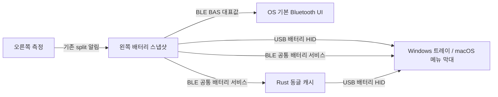

# Windows·macOS 배터리 표시 설계

작성일: 2026-09-13. 기준: `5b0fefcff9af3cc4876bb420f86f6b471eed55ba`.
상태: 실험 브랜치 구현 및 Windows/ARM 자동 검증 진행. macOS 빌드·실기는 미검증. 실제 결과는 BATTERY_DESKTOP_TESTING_ko.md 참조.

## 1. 결정과 지원 범위

Windows 트레이 앱과 macOS 메뉴 막대 앱에서 USB 유선·Bluetooth·Rust 동글 모두 좌우 배터리를 표시한다. Bluetooth에는 표준 Battery Service(BAS)를 함께 제공한다. 아래 OS 범위는 구현 목표이며 이미 검증된 호환성 선언이 아니다.

| OS / 연결 | 필수 사용자 경험 | OS 기본 표시 |
|---|---|---|
| Windows 11 / USB 유선 | 트레이 메뉴에 왼쪽·오른쪽 %와 상태 | 보장하지 않음 |
| Windows 11 / Bluetooth | 트레이 메뉴에 왼쪽·오른쪽 %와 상태 | BAS 대표값 표시를 실기 합격 조건으로 둠 |
| Windows 11 / Rust 동글 | 트레이 메뉴에 왼쪽·오른쪽 %와 상태 | 보장하지 않음 |
| macOS 13 이상 / USB 유선 | 메뉴 막대에 대표값, 메뉴에 좌우 %와 상태 | 보장하지 않음 |
| macOS 13 이상 / Bluetooth | 메뉴 막대에 대표값, 메뉴에 좌우 %와 상태 | BAS 제공 후 실기 관찰; 필수 기능은 앱에서 보장 |
| macOS 13 이상 / Rust 동글 | 메뉴 막대에 대표값, 메뉴에 좌우 %와 상태 | 보장하지 않음 |

Windows x64/ARM64, macOS Apple Silicon/Intel을 빌드 대상으로 설계한다. 실제 배포 지원표에는 테스트한 OS 버전·아키텍처만 검증됨으로 표시한다. Windows 10과 순정 동글 프로토콜은 이번 필수 범위가 아니다.
Apple의 기본 배터리 UI 문서는 Apple 액세서리를 설명하므로 NocFree에도 같은 표시가 된다고 단정하지 않는다. USB 전원을 배터리 충전 중으로 표시하지 않으며, 노트북 시스템 배터리나 UPS로 가장하지 않는다.

## 2. 현재 코드와 재사용 범위

| 위치 | 확인한 현재 동작 | 설계 반영 |
|---|---|---|
| `src/battery.rs` | ADC 환산·전압 필터·순정 기준 % 계산 | 계산을 재사용; 정확도 보정은 별도 실측으로 검증 |
| `src/bin/central.rs`, `src/bin/right.rs` | 부팅·요청·60초 타이머에 측정 | 절대 기한 기반 주기로 바꿔 다른 이벤트가 측정을 계속 미루지 않게 함 |
| `src/split_ble.rs` | 오른쪽 배터리 notify와 측정 요청 명령 | 기존 형식 유지, split 준비 직후 기존 요청 명령으로 최신값 확보 |
| `src/bin/central.rs` | 오른쪽 최신값 보관, Fn+I 문자열 출력 | 수신 시각·split 연결 여부 추가; 기존 출력 유지 |
| `src/link_protocol.rs` READ_BATTERY | `[OK, 0xff, 0xff, 0xff]` 반환 | 기존 응답 길이 유지, 확인된 좌우 슬롯에 실제값 연결 |
| `src/link_usb.rs` | vendor bulk + WinUSB descriptor | 기존 Link 기능 유지; 새 앱의 공통 통신 기반으로 강제하지 않음 |
| `src/ble_hid.rs` | HID와 동글 전용 서비스만 등록 | BAS와 공통 배터리 서비스 추가 |
| `src/dongle_protocol.rs`, `src/dongle_ble.rs` | 고정 길이 키보드·미디어 상태 전달 | 키 패킷 변경 없이 별도 배터리 서비스 선택 탐색 |
| `src/bin/dongle.rs` | USB HID 입력과 CDC 복구 제어 | 별도 배터리 HID 추가; CDC를 배터리 조회에 사용하지 않음 |

동글 CDC는 1200 baud에서 부트로더 진입, 2400 baud에서 bond 삭제를 수행하므로 앱은 COM 포트를 열거나 baud를 변경하지 않는다. 현재 USB serial은 `RUST-LEFT`/`RUST-DONGLE` 상수이므로 장치 통합 식별자로 쓰지 않는다.

## 3. 전달 구조



왼쪽이 좌우 값·신선도·선택 출력의 권위자다. 앱과 동글은 ADC 환산을 다시 하지 않는다. USB와 동글은 동일 HID 계약, 직접 Bluetooth와 동글 내부 링크는 동일 GATT 계약을 사용한다. 배터리 업데이트는 키 입력 큐를 사용하지 않는다.

## 4. 공통 스냅샷 v1

20바이트 고정, 다중 바이트 정수는 little-endian. BLE 기본 ATT MTU 23의 단일 notification에 들어간다. USB에서는 Report ID 1이 앞에 붙어 21바이트가 된다.

| offset | 크기 | 필드 | 의미 |
|---|---|---|---|
| 0 | 1 | version | 1; 미지원 버전은 해석 중단, 앱에 업데이트 필요 표시 |
| 1 | 1 | flags | bit0 왼쪽 연결, bit1 오른쪽 split 준비됨, bit2 왼쪽 값 유효, bit3 오른쪽 값 유효; 나머지 0 |
| 2 | 8 | keyboard_id | 왼쪽 FICR DEVICEID의 두 u32를 순서대로 인코딩; 동글도 왼쪽 ID 전달 |
| 10 | 2 | sequence | 왼쪽 스냅샷 갱신마다 증가, u16 순환; 재연결 시 비교 기준 초기화 |
| 12 | 1 | left_percent | 0..100 또는 255(알 수 없음) |
| 13 | 1 | right_percent | 0..100 또는 255(알 수 없음) |
| 14 | 2 | left_age_s | 측정 이후 경과 초, 65534 포화, 65535 미측정 |
| 16 | 2 | right_age_s | 오른쪽 알림 수신 이후 경과 초, 동일 포화/미측정 규칙 |
| 18 | 1 | selected_output | 0 USB, 1 직접 BLE, 2 Rust 동글, 255 알 수 없음 |
| 19 | 1 | reserved | 0 |

오른쪽 age는 기존 프로토콜을 유지하기 위한 수신 기준 근사값이다. 오른쪽은 매 측정 결과를 알리고, 재연결 시 이전 연결의 대기값 대신 새 측정 결과를 우선한다. 수신 이후 경과 시간만으로 원격 ADC 시각을 정확히 복원했다고 주장하지 않는다.
미연결 또는 180초 초과 값은 유효 bit를 내리고 %를 255로 정규화한다. 미연결은 즉시 반영한다. 101..254, 잘못된 길이, v1의 비정상 flags/예약값은 버리고 이전 정상값의 시간만 경과시킨다. 0%는 유효한 실제 값이다.
앱 수신 시각이 아닌 원본 age를 기준으로 판단한다. 동글은 캐시 age에 로컬 경과 시간을 더해 전달하므로 USB polling이 오래된 측정을 새 측정으로 만들지 않는다. 앱도 마지막 수신 이후 경과 시간을 더한다. 절전 복귀 때 캐시를 무효화하고 재조회한다.
왼쪽은 유효한 첫 측정 이후 호스트 광고를 시작한다. ID는 읽기 전용 하드웨어 값으로 만들며 FICR/UICR/flash를 수정하지 않는다. ID는 인증 수단이 아니며 광고 이름이나 로그에 불필요하게 노출하지 않는다.

## 5. 전송별 계약

**USB 유선·동글:** 별도 vendor-defined HID top-level collection을 추가한다. 제안 Usage Page `0xff60`, Usage `0x01`, Report ID `1`, read-only Feature payload 20바이트. Windows는 HidD_GetFeature, macOS는 IOHIDDeviceGetReport를 사용한다. 동일 Report ID의 Input 보고서 20바이트와 IN endpoint는 HID 열거를 위해 정의하되 v1 앱은 Feature 조회만 사용한다. 인터페이스 자원은 첫 프로토타입에서 확인한다.
키보드·미디어 HID descriptor, 기존 Link 인터페이스와 DFU/CDC 순서를 보존하고 새 인터페이스를 뒤에 추가한다. 추가 OUT endpoint나 설정 쓰기 명령은 만들지 않는다. GET_REPORT handler는 이미 보관한 스냅샷만 복사하며 ADC나 BLE 응답을 기다리지 않는다.
앱은 VID/PID 후보에 더해 Usage Page/Usage와 프로토콜 버전을 확인한다. 모든 키보드 장치를 열어 탐색하지 않는다. 30초마다 조회하고 연결·앱 시작·메뉴 열기에는 즉시 조회한다. 메뉴 재열기는 2초 이내 중복 조회를 합친다. 연결 해제는 OS 장치 알림으로 즉시 반영한다.

**직접 BLE·동글 내부 BLE:** 제안 service UUID `f3641600-00b0-4240-ba50-05ca45bf8abc`, characteristic `f3641601-00b0-4240-ba50-05ca45bf8abc`, read+notify, 기존 JustWorks 보안 수준의 암호화 요구. 현재 `src` 내 UUID 충돌 없음. 실제 코딩 직전 재확인한다.
지속 연결인 동글은 최초 subscribe 후 read하고, 펌웨어는 측정·연결 상태·출력 모드 변경 시 notify한다. Windows/macOS 앱은 30초 간격의 최대 5초 읽기 전용 세션으로 조회하고 즉시 해제한다. 앱은 CCCD를 주기적으로 쓰지 않는다. 값이 같아도 새 측정 완료를 전달한다. 순서 역전은 sequence의 modulo 차이가 1..32767일 때만 새 측정으로 인정한다. 같은 sequence의 재조회는 중복 측정으로 처리하되 age는 기존 경과 시간과 응답 중 더 오래된 값을 적용하고 무효화는 수용한다. 재연결·절전 복귀는 기준을 버리고 다시 read한다.
전송 혼잡 시 배터리 상태는 최신 한 건으로 합치고 다음 기회에 재시도한다. 키 입력 전송을 기다리게 하지 않는다. 알림 구독 실패는 조회 fallback과 오류 상태로 처리하며 키보드 연결을 끊지 않는다.
동글은 기존 HID 서비스 탐색을 먼저 완료하고 공통 배터리 서비스를 별도로 선택 탐색한다. 기존 mandatory gatt_client에 새 필수 필드를 추가하지 않는다. 구형 왼쪽에서 서비스가 없으면 키 입력을 계속하고 배터리는 미지원으로 표시한다.
동글에 키보드가 없으면 ID 0, 연결/유효 flags 0, % 255, age 65535, output 255를 반환한다. 연결이 끊기거나 다른 키보드로 재페어링하면 이전 ID·캐시를 즉시 지운다.

**BAS:** service `0x180f`, Battery Level `0x2a19` read+notify 하나를 제공한다. 유효한 양쪽 중 낮은 값을 대표값으로 쓰고, 오른쪽이 없으면 왼쪽을 쓴다. 어느 값도 유효하지 않을 때 BAS에 255를 보내지 않는다. 마지막 유효 BAS 값은 유지하되 앱은 공통 스냅샷의 무효 상태를 표시한다. OS 기본 UI가 오래된 값을 보유하는 한계는 필수 앱 표시와 구분한다.
대표값 대상 구성이 같은 방전 구간에서 BAS 값은 내려가기만 하도록 latch한다. 확인된 충전 전원 연결 또는 배터리 재설치 때 상승을 허용하고 단순 BLE 재연결로 latch를 풀지 않는다. 재부팅 후 초기 추정과 대표값 대상 구성이 바뀌는 경우는 별도로 검증한다. raw 전압 반등을 충전으로 추정하지 않는다. 충전 감지 신호가 확인되지 않은 오른쪽은 충전 여부를 알 수 없음으로 유지한다. 오른쪽 충전 후 BAS 상승을 정확히 처리할 하드웨어 근거는 2단계 실측 항목이며, 확인 전 BAS 충전 추적까지 준수했다고 표시하지 않는다. BAS는 이 감소 필터 때문에 앱의 기존 전압 기반 추정 %보다 낮을 수 있다.
Windows의 BAS 지침은 방전 중 값이 오르내리지 않는 처리를 요구한다. BAS 1.1 충전 상태·잔여 시간·추가 알림은 센서 근거가 없는 현재 범위에서 구현하지 않는다. [Microsoft BAS 지침](https://learn.microsoft.com/en-us/windows-hardware/design/accessory-guidelines/bluetooth-accessory-guidelines/bluetooth-accessory-guidelines-battery-profiles-services)

## 6. 앱과 사용자 경험

Windows는 C#/.NET + WinForms NotifyIcon, WinRT GATT와 HID API를 사용한다. macOS는 Swift/AppKit NSStatusItem + CoreBluetooth + IOKit을 사용한다. 작은 네이티브 앱 두 개로 시작하고 공통 wire 명세·상태 규칙·golden fixture를 공유한다. 배터리 메뉴만을 위해 웹 런타임이나 Rust↔Swift/C# FFI 계층을 추가하지 않는다. SDK/런타임 버전은 구현 시 지원 OS에서 빌드 검증한 버전으로 고정한다.
Windows 트레이는 배터리 상태 아이콘과 tooltip `NocFree · L 80% / R 65%`, macOS 메뉴 막대는 `NF 65%`를 기본으로 한다. 두 앱의 메뉴는 다음 내용으로 통일한다.

```text
NocFree · 동글
왼쪽   80%
오른쪽 65%
마지막 측정 24초 전
새로 고침
로그인 시 실행 [사용자 선택, 기본 꺼짐]
종료
```

알 수 없음, 연결 끊김, 업데이트 지연, 펌웨어 미지원, Bluetooth 권한 필요를 구별한다. 하나만 유효하면 그 값을 대표로 쓰되 메뉴에서 누락된 쪽 상태를 보여준다. 양쪽 모두 무효면 대표 숫자 대신 `--`를 표시한다. 새로 고침은 전송 캐시를 읽는 동작이며 강제 ADC 측정·Fn+I 타이핑을 발생시키지 않는다.
keyboard_id가 같은 유선·BLE·동글 경로를 하나의 키보드로 묶는다. 신선한 경로 중 유선→동글→직접 BLE 순으로 조회 경로를 선택하며, 표시 연결 방식은 selected_output에서 가져온다. 서로 다른 키보드는 별도 메뉴 항목으로 표시한다. ID 0인 동글은 미연결 수신기로만 표시한다.
BLE 앱은 OS에서 이미 연결된 NocFree를 우선 찾고 선택된 호스트 프로필을 바꾸지 않는다. macOS는 retrieveConnectedPeripherals에서 HID service `0x1812` 또는 공통 배터리 service로 후보를 얻고 NocFree 공통 service를 확인한다. Windows는 연결 상태/장치 감시 후 GATT 접근을 사용한다. 추가 128-bit UUID를 광고에 모두 넣는 것을 전제로 하지 않는다. OS HID 연결과 앱의 GATT 접근이 함께 동작하는지는 1단계 실기로 검증한다. 상시 스캔·강제 연결 유지로 펌웨어의 sleep을 막지 않는다.
권한을 거부하면 BLE만 권한 필요 상태로 표시하고 USB/동글은 계속 동작한다. macOS에는 Bluetooth 사용 목적 문자열을 넣는다. USB 접근은 배터리 collection만 비독점으로 열고 키 입력 모니터링 권한에 기대지 않는다. OS에서 요구하는 실제 권한은 프로토타입으로 확인한다.
알림·충전 완료·잔여 사용 시간·자동 업데이트·클라우드·키맵 편집은 v1에 추가하지 않는다. macOS는 Developer ID 서명·notarization한 직접 배포 앱을 목표로 하고, Windows는 서명 배포를 준비한다. 인증서와 Mac 빌드/실기 환경 확보는 구현·출시 단계의 외부 의존성이다.

## 7. 기존 기능과 업데이트 호환성

새 왼쪽+구 동글은 기존 키 패킷으로 입력을 유지한다. 구 왼쪽+새 동글은 배터리 미지원으로 입력을 유지한다. 새 앱+구 펌웨어는 대상 collection/service가 없으면 미지원으로 표시하며 추정값을 만들지 않는다. 오른쪽의 기존 배터리 characteristic과 명령은 유지한다.
Link READ_BATTERY는 배포 프런트엔드 또는 기존 계약 자료에서 좌우/세 번째 슬롯 의미를 확인한 뒤 실제값을 연결한다. 세 번째 값을 임의의 동글 배터리로 채우지 않는다. 이 보조 호환 작업이 새 앱의 동작 전제는 아니다.
GATT 구조 변경에 대비해 Service Changed와 bond별 system attributes 저장/복원을 점검한다. 현재 platform의 기본 attribute table 크기와 SoftDevice RAM도 측정한다. 캐시 무효화를 구현하지 못하면 재페어링 필요 조건을 릴리스에 명시하며, 앱이 자동으로 bond를 삭제하지 않는다. [Windows GATT 캐시](https://learn.microsoft.com/en-us/uwp/api/windows.devices.bluetooth.bluetoothcachemode)
USB는 VID/PID와 기존 인터페이스 계약을 유지하고 descriptor revision을 갱신한다. 인터페이스 추가 후 Windows/macOS의 이전 장치 캐시, Link 동시 사용, DFU 복구를 다시 검사한다. 배터리 때문에 bootloader·factory filesystem·UICR·키맵/bond 저장 포맷을 변경하지 않는다.

## 8. 구현 순서와 합격 조건

1. **OS 접근 프로토타입:** 왼쪽에 배터리 HID와 공통 BLE 서비스 최소 구현, 두 OS의 진단 리더로 조회. 고정 fixture 값은 진단 전용 빌드에서만 사용. 입력 동시 동작, macOS 권한, GATT 동시 접근, USB endpoint/SoftDevice 메모리 여유를 확인한 뒤 다음 단계로 진행한다.
2. **실제 상태 연결:** 좌우 측정 주기·신선도·disconnect 무효화·재연결 요청·ID·BAS 연결. 공통 형식과 상태 정책을 순수 코드로 검증한다. Fn+I 및 Link 계약의 확인된 범위와 값 일치를 검사한다.
3. **동글 확장:** 선택 GATT 탐색·캐시 age 누적·USB Feature 응답을 추가한다. 구/신 왼쪽과 동글의 네 조합에서 입력/복구를 검증한다.
4. **네이티브 앱:** 트레이/메뉴 막대·자동 탐색·중복 통합·권한/미지원 상태·절전 복귀를 구현한다. 두 앱은 동일한 golden payload와 상태 시나리오를 통과해야 한다.
5. **배포 검증:** 아래 여섯 조합 실기, 배열별 빌드 및 역할별 artifact/hash, 서명·설치·제거 확인 후 지원표를 갱신한다. 펌웨어 실기 배포는 별도 사용자 지시가 있을 때 수행한다.

자동 검사에는 20바이트 codec round-trip과 잘못된 길이/버전/예약값 거부, 실제 0%와 unknown 구분, 180초 경계, age 포화, sequence 순환/구독-read 역전, 한쪽 단절·재접속·수신기만 연결·키보드 교체·중복 경로·절전 복귀를 포함한다. 계속되는 백라이트 이벤트가 측정을 굶기지 않는지 가짜 시계로 검증한다.
HID descriptor Feature 길이/ID와 GET_REPORT 응답을 함께 검증하고, GATT 선택 탐색 실패가 키 입력 실패로 전파되지 않는 테스트를 둔다. BAS에는 255가 나가지 않고 방전 중 노이즈로 상승하지 않는지 검사한다. 기존 host suite, ANSI/ISO/JIS/KR ARM Left/Right와 공용 동글 빌드, UF2 보호영역 검사를 실행한다. 문서 텍스트 포함 여부만으로 구현 합격을 판정하지 않는다.

| 실기 항목 | 합격 기준 |
|---|---|
| Windows/macOS × 유선/BLE/동글 | 이미 연결·측정된 장치는 앱 시작 후 5초 내 좌우 표시; cold/reconnect 새 측정은 10초 목표, 지연 시 측정 대기 표시 |
| 갱신 | 새 측정 후 동글 내부 BLE는 5초, 세 연결 방식의 앱은 35초 이내 반영; 조회는 ADC 주기를 앞당겼다고 표시하지 않음 |
| 단절/노후화 | 직접 USB 제거는 5초 목표; 앱의 무선 단절은 OS 이벤트 또는 다음 조회(35초 목표)에 무효화하고 동글 내부 단절은 supervision timeout 이후 USB 조회(35초 목표)에 반영; 누락 측정은 180초+전송/조회 지연 이내 업데이트 지연 |
| 동글만 연결·오른쪽 OFF | 가짜 0%/100%와 이전 키보드 잔량 없음 |
| 절전·프로필·출력 전환 | 호스트 변경을 앱이 되돌리지 않음; wake 후 새 값, 중복 장치 없음; 기존 System OFF 진입 유지 |
| 입력·부가 기능 회귀 | 빠른 양손 입력·미디어·유선/BLE 포인터·백라이트·Fn+I·Link·양쪽/동글 복구 통과 |
| 전력·정확도 | 앱 유무의 idle/System OFF 전류와 배터리 추세 비교, 의도치 않은 지속 연결 없음; DMM 및 방전 구간 실측 전에는 정확도 보정 완료로 표시하지 않음 |
| OS 기본 UI | Windows BLE 대표값 확인; macOS는 표시 여부와 OS 버전을 기록하고 미표시여도 앱 여섯 조합은 합격해야 함 |

숫자 시간 기준은 설계 목표다. 측정된 불일치는 원인과 변경안을 기록하고 해결 전 해당 경로를 지원 완료로 표시하지 않는다. Mac 실물이 없으면 macOS 구현을 빌드만 통과한 상태로 구분한다.

## 9. 근거와 설계 검토 결과

USB Feature 조회는 [Microsoft HidD_GetFeature](https://learn.microsoft.com/en-us/windows-hardware/drivers/ddi/hidsdi/nf-hidsdi-hidd_getfeature)와 [Apple IOHIDDeviceGetReport](https://developer.apple.com/documentation/iokit/1588659-iohiddevicegetreport)에 근거한다. 두 OS가 같은 배터리 HID 계약을 읽도록 하는 것은 이 API를 이용한 설계 선택이다.
macOS BLE 접근과 메뉴는 [CoreBluetooth](https://developer.apple.com/documentation/corebluetooth), [연결된 peripheral 조회](https://developer.apple.com/documentation/corebluetooth/cbcentralmanager/retrieveconnectedperipherals(withservices:)), [Bluetooth 사용 목적](https://developer.apple.com/documentation/bundleresources/information-property-list/nsbluetoothalwaysusagedescription), [NSStatusBar](https://developer.apple.com/documentation/appkit/nsstatusbar)를 사용한다. [Apple 배터리 표시 안내](https://support.apple.com/en-la/102292)는 Apple 액세서리 대상이며 NocFree의 기본 UI 지원 증거로 사용하지 않는다.
2026-09-13 소스·공식 문서 대조로 여섯 연결/OS 계약, 데이터 형식·신선도·호환성, 단계별 검증 계획을 수동 검토했다. 이 문서의 합격 조건은 구현 증거가 아니다. 실제 실행한 검사와 미실행 실기 항목은 BATTERY_DESKTOP_TESTING_ko.md에 별도로 기록한다.
