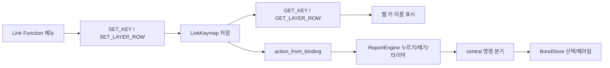

# NocFree Link 전체 키·설정 호환성 수정 설계

작성일: 2026-09-06
대상: `NocFree-and-rust`, 기준 커밋 `cdcd20d46baadb396364db6ecb0ce22e2edec947`
상태: 펌웨어 구현·전 배열 릴리스 검증 완료. 웹 UI 라벨 변경은 Link 웹 소스가 필요함.

## 1. 결론과 범위

**Link에서 표시·저장·실행하는 의미가 모든 지원 기능에서 일치하도록 호환성 경계를 수정**해야 한다. 사용자 추가 요청에 따라 블루투스뿐 아니라 일반 키, 미디어, 백라이트, 레이어, 복합키, 단축키, OS 설정, DFU, 부가 설정과 저장 데이터까지 포함한다.

현재 기본 Fn 블루투스 키와 웹 Function 메뉴에서 다시 지정한 블루투스 키는 서로 다른 Action으로 실행된다. 기본키에는 있는 길게 누르기 페어링 기능이 웹 재지정 후 사라진다. 별도로, 웹이 모르는 자체 키코드를 그대로 읽어 가면서 `0x0040`, `0x0050` 같은 표시가 생긴다.

권장 순서는 다음과 같다.

1. 전체 웹 키 목록과 명령별로 지원·수정 필요·명시적 미지원 상태를 정리한다. 의미가 다른 실행이나 가짜 저장 성공을 먼저 막는다.
2. BLE·미디어·백라이트·OS·DFU·레이어·hotkey의 확인된 호환성 결함을 수정한다.
3. LT/MT처럼 저장은 되지만 의미가 손실되는 기능은 올바른 실행을 구현하기 전까지 미지원으로 처리한다.
4. 웹에는 Rust 전용 라벨과 지원 범위를 표시한다. 사이트 수정 권한이 없다면 공식 사이트 화면 전체의 완료 조건을 만족할 수 없다는 한계를 남긴다.

이 문서는 구현 기준과 남은 외부 의존성을 함께 기록한다. 첨부 이미지는 증상 자료로만 사용했다.

### 구현 상태

현재 펌웨어 변경은 BLE·표준 백라이트·Consumer·OS·왼쪽 DFU·레이어·hotkey와 Link
프로토콜의 읽기/쓰기 경계를 다룬다. 지원하지 않는 Mouse, Quick Text, LT/MT, 2.4G,
동글 DFU, 밝기·절전 설정은 거부 응답으로 처리해 기존 키맵을 손상시키지 않는다.

`link.nocfree.com`의 배포 JavaScript만 확인할 수 있었고, 수정 가능한 웹 소스는 작업
폴더와 공개 검색 결과에서 찾지 못했다. 따라서 펌웨어가 표준 Link 코드로 돌려줄 수 있는
BLE·백라이트 표시는 개선되지만, Rust 전용 private 코드 전체의 웹 라벨 변경은 이 저장소만
으로 완료할 수 없다. 웹 소스를 받으면 5장 D의 Rust 프로필과 라벨 보존 작업을 이어서
적용한다.

2026-09-06에 ANSI/ISO/JIS/KR host 검사와 각 배열의 Left·Right ARM 릴리스, 공용
동글 빌드, UF2·저장소 검사를 통과했다. 이 결과는 실기 Link 통신이나 Bluetooth
페어링을 대신하지 않으며, 새 ANSI Left UF2를 장치에 올리는 작업은 별도 사용자 지시가
있을 때만 수행한다.

## 2. 분석 전제와 확인 범위

- 작업 폴더의 여러 구현 중 `src/link_keymap.rs`, `src/link_protocol.rs`, `src/link_usb.rs`를 갖춘 Rust 구현을 분석 대상으로 선택했다. 이미지의 자체 코드가 이 구현의 기본 Fn 레이어와 일치한다.
- 사용 중인 장치의 펌웨어 해시, 실제 저장 키맵, 선택된 출력 모드와 bond 상태는 읽지 않았다. 따라서 장치의 모든 블루투스 장애를 동일 원인으로 확정하지 않는다.
- 웹은 [NocFree Link](https://link.nocfree.com/)가 현재 제공하는 [배포 JavaScript](https://link.nocfree.com/assets/index-BQka7NBX.js)를 확인했다. 웹 소스 프로젝트는 이번 분석 범위에서 확보되지 않았다.
- 확인한 JavaScript의 SHA-256: `C8B12DC7B89E84B021E458FF7A3BE46E03D98FABF0ED365C036DEE58167B2324`. 웹 함수명은 압축된 배포 파일 기준이므로 다음 배포에서 달라질 수 있다.

### 설계의 완료 기준

- 화면 표시 문제와 실제 BLE 동작 문제를 구분하고 코드 근거를 제시한다.
- GET/SET, Action 실행, 저장 데이터의 호환성을 함께 설계한다.
- 모든 웹 키 분류와 부가 설정 명령을 검사 대상으로 포함한다. 정상 지원 기능이 다른 기능으로 바뀌거나 무동작으로 저장되는 일을 방지한다.
- 구현 후 자동 검사와 실기 합격 조건을 명시한다.
- 확인되지 않은 장치 상태와 웹 수정 권한을 사실처럼 가정하지 않는다.

## 3. 확인된 원인

### 3.1 기본키와 웹에서 지정한 BLE 키의 동작이 다르다

| 경로 | 저장/전송 표현 `(kind, value)` | 현재 Action | 짧게 누르기 | 1초 누르기 |
|---|---|---|---|---|
| 기본 Fn+1/2/3 | `(0x80, 0x40..0x42)` | `ProfileShortcut(0..2)` | 뗄 때 슬롯 선택 | 해당 슬롯 bond 삭제 후 페어링 |
| 웹 Function의 BLE1/2/3 | `(3, 2..4)` | `ProfileSelect(0..2)` | 누를 때 즉시 슬롯 선택 | 추가 동작 없음 |

웹 배포 파일의 BLE1~3 정의는 `type=3`, `value=2,3,4`이다. 웹 툴팁은 길게 눌러 채널을 바꾼다고 안내한다. 그러나 Rust에서는 `action_from_binding()`이 이 값을 즉시 선택용 `ProfileSelect`로 해석한다.

`ReportEngine`의 페어링 타이머는 `ProfileShortcut`에만 적용된다. 따라서 Function 메뉴에서 기존 BLE 키를 덮어쓰면 `ProfilePair`가 발생하지 않는다. `BondStore::select()`는 페어링 상태를 끄고, `selected_connectable()`은 bond도 페어링 상태도 없는 슬롯을 연결 가능 상태로 보지 않는다. 빈 슬롯에서는 사용자가 “블루투스가 작동하지 않는다”고 느낄 수 있다.

이는 현재 코드와 독립 실행형 재현 검사로 확인했다. 실제 사용 장치가 빈 슬롯이었는지는 미확인이다.

### 3.2 `0x...`는 주로 알 수 없는 키코드의 표시다

`GET_KEY`, `GET_LAYER_ROW`는 저장된 `LinkBinding`을 그대로 응답한다. 웹의 `Ol(type, value, ...)`은 키 목록에서 **type과 value를 함께** 검색하며, `type=0x80`은 목록에 없다. 이 경우 value만 4자리 16진수로 표시한다.

| 이미지의 표시 | 코드에서 대응하는 기본 기능 |
|---|---|
| `0x0040` / `0x0041` / `0x0042` | BLE 슬롯 1/2/3 단축키 |
| `0x0050` / `0x0051` / `0x0052` | 백라이트 토글/감소/증가 |
| `0x0053` | 배터리 상태 |
| `0x0054` / `0x0055` | OS에 따라 달라지는 F3/F4 기능 |
| `0x0056` / `0x0057` | macOS/Windows 단축키 |
| `0x0001` / `0x0002` / `0x0003` | 왼쪽 재시작/오른쪽 DFU/왼쪽 DFU |

이미지에는 kind가 보이지 않으므로 이 표는 이미지 위치와 코드에 근거한 대응이다. 실제 응답 패킷을 읽은 결과는 아니다. `Trans`는 투명 바인딩의 정상 표시이며, 그 자체가 데이터 손상을 뜻하지 않는다. numpad가 보인다는 사실도 Rust numpad 지원이나 물리 연결을 증명하지 않는다.

### 3.3 미디어 키도 같은 경계에서 의미가 바뀐다

`binding_from_action()`은 일부 음량 키만 Link 값으로 바꾸고, 나머지 Consumer usage는 그대로 저장한다. 그런데 역변환은 같은 숫자를 Link 코드로 해석한다.

| 의도한 기본 Action | 현재 저장 값 | 웹/역변환 결과 | 올바른 Link 값 |
|---|---|---|---|
| 이전 곡 `Consumer(0x00b6)` | `(2,182)` | `Back` / `Consumer(0x0224)` | `(2,172)` |
| 다음 곡 `Consumer(0x00b5)` | `(2,181)` | `Home` / `Consumer(0x0223)` | `(2,171)` |
| 재생/일시정지 `Consumer(0x00cd)` | `(2,205)` | 웹에서 `0x00cd` | `(2,174)` |
| 화면 밝기 증가 `Consumer(0x006f)` | `(2,111)` | 웹에서 `0x006f` | `(2,189)` |
| 화면 밝기 감소 `Consumer(0x0070)` | `(2,112)` | 웹에서 `0x0070` | `(2,190)` |

첨부 화면의 `Back`, `Home`, `0x00cd`, `0x006f`, `0x0070`과 부합한다. 이전 곡이 브라우저 뒤로가기로 역변환되는 문제는 실행 검사로도 확인했다. 숫자 표시만 숨기면 이 동작 오류가 남는다.

### 3.4 전체 기능 점검에서 추가로 확인한 불일치

웹 배포 파일의 정적 키 정의는 **254항목, 중복을 제외한 `(type,value)`는 246개**였다. 언어·지역별 라벨 중복이 있으며, 동적으로 생성되는 hotkey/text 및 LT/MT 조합은 이 수에 포함하지 않는다. 따라서 246개만 검사하고 전체 호환이라고 선언해서는 안 된다.

| 영역 | 현재 코드에서 확인한 문제 | 설계상 처리 |
|---|---|---|
| Windows/macOS | 웹은 Windows=0/Mac=1, Rust 저장값은 Windows=1/Mac=0. SET/READ_SYSTEM이 그대로 전달됨. 웹은 연결 시 호스트 OS를 자동 SET함 | 프로토콜 입출력에서만 값 반전, 내부 의미·저장 형식 유지 |
| Function OS 키 | `(3,6/7)` Switch Win/Mac은 `NoAction` | 명시적인 즉시 OS 선택 Action으로 연결. 기존 M/N tap-hold와 구분 |
| Left DFU | `(3,19)`가 `ResetLeft`로 실행됨 | `BootLeft`로 수정하고 Rust의 3초 조건을 웹에서 안내 |
| 일반 키 범위 | SET은 0..255를 허용하지만 report는 ANSI/ISO/KR 0x04..0x73, JIS 0x04..0x8a 및 수정키만 출력 | 실제 HID 출력 가능 범위를 검증. Language/International 등 범위 밖의 키를 성공으로 저장하지 않음 |
| 마우스 키 | 웹 type 0의 205..223은 마우스 기능인데 Rust는 일반 Key로 받아 report에서 누락 | Mouse 전체를 명시적 미지원으로 분류. Keyboard usage로 오인하지 않음 |
| LT | `0x2000` 계열이 tap key를 버리고 즉시 레이어 hold로 바뀜 | tap/hold 구현 전 저장 거부; 구현 시 구분된 Action 필요 |
| MT / MT_FN / Globe | `0x3000` 계열이 tap/hold 대신 동시 Chord. Fn/Globe slot 8/9는 modifier=0이 됨 | Chord로 대체하지 않음. 각 hold 종류를 구분해 구현 |
| 레이어 | 코드 96과 98이 모두 LayerToggle(1). 웹은 96을 기본 Layer 1, 98을 Fn으로 별도 제공 | 웹의 layer index를 확인해 기본 레이어 복귀 경로 보장. 이름만 보고 토글 의미를 추측하지 않음 |
| hotkey 재지정 | 좌표에 연결된 hotkey가 새 일반 binding보다 우선함 | 일반 키 재지정 시 해당 좌표 연결 해제. 다른 좌표·슬롯 내용은 유지 |
| 레이어/전체 초기화 | reset은 binding만 복구하고 좌표 hotkey는 남음 | 레이어 초기화는 해당 레이어 연결, 전체 키맵 초기화는 모든 좌표 연결도 해제 |
| Consumer 전체 목록 | 175/191/192 등은 명시 변환 없이 숫자 그대로 Consumer usage로 사용 | 웹 논리 코드와 실제 HID usage의 대응을 검증한 항목만 지원. 임의 fallback 금지 |
| 텍스트 | GET_TEXT는 빈 슬롯, 저장 등은 BAD_ARG지만 `(3,80..95)` 바인딩은 성공 허용 | 텍스트 바인딩도 거부하고 UI에 미지원 표시 |
| 밝기/절전 설정 | 웹 READ/SET_BRIGHTNESS(87/88), READ/SET_SLEEP(89/90)을 Rust가 처리하지 않아 응답 없음 | 지원 전까지 대응 response op와 오류를 반환해 타임아웃 방지 |
| 웹 DFU 명령 | ENTER_LEFT_UF2(82)를 Rust가 처리하지 않음 | 초기에는 명시적 미지원 응답. 키 DFU의 검증된 독립 복구 경로 유지 |

Language/International 키를 실제 지원하려면 bitmap만 늘리면 끝나지 않는다. USB·BLE descriptor, report 크기, 동글의 고정 19-byte universal report와 프로토콜 버전을 함께 변경해야 한다. 이 설계에서는 먼저 현재 지원 범위를 정확히 제한하고, 확장은 별도 호환 빌드 단계로 둔다.

## 4. 현재 처리 흐름과 수정 위치



| 근거 파일·위치 | 확인한 내용 / 수정 책임 |
|---|---|
| `src/keymap.rs:136` | 기본 Fn 기능 정의. 기본 동작의 기준으로 유지 |
| `src/link_keymap.rs:257` | `binding_from_action`: 기본키를 LinkBinding으로 인코딩 |
| `src/link_keymap.rs:297` | `action_from_binding`: 웹 BLE 코드를 선택 전용으로 해석 |
| `src/link_protocol.rs:64` | 단일키 GET/SET 및 행 GET 처리 |
| `src/link_protocol.rs:313` | 행 SET의 선검증 후 적용 구조 |
| `src/link_protocol.rs:337` | kind 3/0x80의 모든 값을 현재 허용 |
| `src/report.rs:138` | 기존 짧게/길게 누르기 및 중복 실행 방지 |
| `src/bond_store.rs:85` | 슬롯 선택과 페어링 상태 변경 |
| `src/bond_store.rs:183` | 저장 Action 해석, 소프트웨어 출력 전환 무효화 |
| `src/bond_store.rs:206` | 변경된 키맵의 비동기 flash 저장 요청 |
| `src/bin/central.rs:193` | 키 명령에서 BLE/동글 제어로 분기 |
| `src/bin/central.rs:580` | BLE 선택/페어링 제어를 BondStore에 전달 |

## 5. 권장 수정 설계

### 공통 계약: 화면 → 저장 → 실행 → 재조회가 같은 뜻이어야 한다

기존 `link_keymap.rs`를 변환 책임의 중심으로 유지한다. 새 키코드 프레임워크나 별도 런타임 서비스는 만들지 않는다.

- `binding_for_link`: 의미를 보존하는 응답 별칭만 적용한다.
- `action_from_binding`: 지원 코드의 실행 의미를 명시적으로 변환한다.
- 공용 유효성 검사: 코드뿐 아니라 현재 배열의 report 범위, hotkey slot, LT/MT 파라미터를 검사한다. 단일 SET과 행 SET이 같은 규칙을 사용한다.
- **새로 지정한 미지원 코드**는 `BAD_ARG`, 잘못된 layer/좌표는 `OOR`로 반환하고 상태·flash dirty flag를 바꾸지 않는다. 유효한 명시적 `No Action`과 미지원 코드를 구분한다.
- **기존에 저장된 알 수 없는 코드**는 조회 시 원본을 보존하고 웹에 `미지원 (type=..., value=...)`로 표시한다. 무변경 재저장은 기존 좌표의 원본과 같을 때만 허용하며 다른 좌표로 새 지정하는 것과 구분한다. 실행 시 다른 기능으로 추측하지 않는다.
- 행 SET은 전 항목 검증 후 한 번에 적용한다. 잘못된 값·중복 좌표·미지원 코드가 하나라도 있으면 전체를 거부한다. 좌표 hotkey 해제도 같은 적용 단계에 포함한다.
- flash decode에서도 layout/version/key count/CRC와 실행 필드 범위를 검사한다. CRC가 맞다는 이유만으로 잘못된 slot·좌표를 실행하지 않는다.
- `LinkKeymap::binding()`은 현재 `then_some` 인자를 먼저 평가해 범위 밖 indexing이 가능하다. 명시적 범위 검사 후 배열에 접근하도록 고쳐 잘못된 GET이 panic 대신 오류가 되게 한다.

웹에서는 SET 응답이 실패하면 새 이름을 확정하거나 저장 완료를 표시하지 않는다. 같은 좌표를 재조회해 실제 값과 표시를 동기화한다. 미지원 버튼을 비활성화하는 조치는 펌웨어의 입력 검증을 대신하지 않는다.

### A. BLE를 기존 단축키 실행 경로로 통일한다

`action_from_binding()`에서 `(3,2..4)`를 `ProfileShortcut(value-2)`로 해석한다. 기존 `(0x80,0x40..0x42)`도 그대로 지원한다. 타이머나 BLE 상태 머신을 새로 만들지 않는다.

목표 동작은 현재 Rust 기본키 및 README와 동일하게 정한다.

- 누르는 순간에는 선택/페어링 명령을 실행하지 않는다.
- 1,000ms 미만에 떼면 해당 슬롯을 한 번 선택한다.
- 1,000ms 이상 유지하면 해당 슬롯을 한 번 새로 페어링한다.
- 길게 누르기 이후 떼어도 선택/페어링 명령이 추가로 발생하지 않는다.
- 유지 중 타이머 검사를 못 했더라도, 1,000ms 이후 release 경로에서 한 번 실행한다.

이것은 순정 펌웨어의 타이밍까지 재현한다는 주장이 아니라 Rust의 기존 사용법을 보존하는 설계 결정이다. 새 페어링은 해당 슬롯의 기존 bond를 삭제하므로 웹 설명에도 이 동작을 밝혀야 한다.

### B. 웹 응답 변환을 한 곳에 둔다

`src/link_keymap.rs`에 작은 순수 함수 `binding_for_link(binding)`를 추가하고, 두 GET 경로가 함께 사용하도록 한다. 내부 저장 형식과 기본 자체 코드는 유지한다.

| 내부 표현 | 웹 응답 표현 | 웹에서 다시 썼을 때 목표 Action |
|---|---|---|
| `(0x80,0x40..0x42)` | `(3,2..4)` | `ProfileShortcut(0..2)` |
| `(0x80,0x50)` | `(3,34)` | `BacklightToggle` |
| `(0x80,0x51)` | `(3,33)` | `BacklightDown` |
| `(0x80,0x52)` | `(3,32)` | `BacklightUp` |

`action_from_binding()`에도 백라이트 표준값 32/33/34를 연결한다. **응답만 예쁘게 바꾸고 재저장 시 실행 의미가 달라지는 상태를 허용하지 않는다.**

두 SET 경로는 기존 프레임 구조와 big-endian value를 유지한다. 레코드의 little-endian 저장 방식도 그대로 둔다. 웹 응답용 별칭은 GET에서만 적용하므로 읽기만으로 flash를 쓰지 않는다.

검증할 불변식은 지원 대상 b에 대해 `action_from_binding(binding_for_link(b)) == action_from_binding(b)`이다. 정확한 `(kind,value)` 보존이 필요한 전용 기능은 변환하지 않는다.

기존 `(0x80,0x10..0x12)`는 즉시 선택 전용 Action이므로 BLE 단축키 별칭으로 바꾸지 않는다. 두 기능의 timing 의미가 다르다.

### C. Consumer 전체 변환과 기본값을 수정한다

`binding_from_action()`에 위 표의 미디어/밝기 usage를 명시적으로 추가한다. 기본 레이어에서 사용하는 Consumer Action 전체에 대해 인코딩 후 디코딩했을 때 원래 usage가 나오는지 검사한다. 음량의 기존 변환도 유지한다.

추가로 웹 Media/WWW/System의 모든 type 2 항목을 목록화한다. 127..129 같은 별칭은 같은 usage로 수렴하도록 하되, 역변환은 하나의 표준 표현을 선택한다. 175/191/192처럼 의미가 아직 확인되지 않은 값은 공식 HID 정의와 순정 동작을 확인하기 전 임의 usage로 전달하지 않는다. OS에서 반응이 없을 수 있다는 것과 잘못된 HID usage를 보냈다는 것을 구분해 검사한다.

저장된 `(2,182)`는 사용자가 지정한 정상적인 `Back`일 수도 있다. 기존 flash 전체에서 181/182를 일괄 변경하지 않는다. 새 기본값만 수정하고, 기존 사용자에게는 해당 미디어 키를 다시 지정하는 복구 절차를 제공한다. 전체 초기화는 필수 조치가 아니다.

### D. 나머지 전용 키는 웹에서 정직하게 표시한다

배터리, 재시작, 양쪽 DFU, OS별 F3/F4, OS 단축키에는 웹 표준 코드와 동작이 정확히 같은 항목이 없거나 timing이 다르다. 이들을 `Trans`, 일반 문자, 비슷한 이름의 Function 코드로 대체하지 않는다.

사이트 수정이 가능하면 실제 웹 소스의 키 정의/라벨 formatter에 `(type,value)` 기반 Rust 전용 라벨을 추가한다. 배포 파일의 압축 함수 `Ol`을 직접 패치하는 방식은 사용하지 않는다.

- 예: `(0x80,0x53)`은 배터리 상태, `(0x80,1)`은 재시작, `(0x80,2/3)`은 오른쪽/왼쪽 DFU로 표시한다.
- 슬롯 선택 전용 키, 삭제 키와 단축키는 서로 다른 설명을 사용한다.
- 조회한 전용 바인딩은 UI 상태와 재저장 패킷에서 원래 type/value를 보존한다.
- 다른 펌웨어의 같은 숫자와 혼동하지 않도록 Rust 프로필로 제한한다. 현재 `READ_VERSION`은 `2.3.0`을 반환하므로 이 값만으로 Rust를 식별할 수 없다. 초기 구현에서는 사용자가 명시적으로 선택하는 Rust 프로필을 사용할 수 있다.
- 현재 비활성화되는 `OutputUsb/OutputBle` 같은 코드에는 실행 가능한 기능인 것처럼 이름만 붙이지 않는다.

웹 변경권이 없으면 A~C는 펌웨어만으로 진행할 수 있지만, 남은 Rust 전용 코드의 `0x...` 표시까지 없어졌다고 완료 보고하지 않는다. 다른 도메인의 설정 도구가 필요하다면 별도 범위로 결정한다.

### E. OS, DFU, 레이어, hotkey를 바로잡는다

**OS:** `SET_SYSTEM`은 웹 0→내부 1, 웹 1→내부 0으로 변환하고, `READ_SYSTEM`은 그 역변환을 한다. `BondStore::set_system()`과 기존 레코드 값은 그대로 둔다. `(3,6/7)`은 새로운 작은 `Action::SystemSelect`를 통해 기존 `Command::SystemSelect`에 연결한다. M/N 문자를 tap하는 기존 `SystemShortcut`을 재사용해 즉시 선택 버튼에 문자나 hold 지연을 섞지 않는다. 과거에 잘못 저장된 OS 값은 작성 경로를 구별할 수 없으므로 일괄 반전하지 않고 사용자의 명시적 선택 또는 수정된 웹 연결 동기화로 복구한다.

**DFU:** `(3,19)`는 재시작이 아닌 왼쪽 DFU Action으로 연결한다. Rust 프로필에서는 기존 `DFU_HOLD_MS=3000`을 사용하고 웹의 순정 5초 설명과 구분한다. `(0x80,1)` 재시작은 별도 의미로 유지한다. 동글 DFU `(3,20)`나 웹 opcode 82는 지원된 것처럼 ACK한 뒤 다른 장치를 재부팅하지 않는다. 웹 opcode를 구현할 때는 응답 전송 완료 후 재부팅하고 기존 복구 절차를 검사한다.

**레이어:** 웹의 화면상 기본 Layer 1과 Fn에 대한 실제 인덱스 계약을 fixture로 고정한다. 권장 대응은 96→내부 기본층 0, 97/98→내부 Fn층 1, 99..110→2..7이다. 배포 UI의 layer 선택 로직으로 이 대응을 검증한 후 적용한다. 높은 layer에서 Transparent일 때 현재 default layer를 먼저 참조한 뒤 base 0으로 내려오도록 해, default를 2로 선택하고 Fn을 누른 상황도 일관되게 처리한다. 눌린 키의 Action은 release까지 유지하고 release 후 modifier·layer가 남지 않아야 한다. `LayerToggle`이라는 내부 이름만 보고 웹 Tap-to-Layer를 켜기/끄기 토글로 변경하지 않는다.

**Hotkey:** 좌표 hotkey가 있는 키에 일반 기능을 저장하면 그 좌표 연결만 해제한다. 슬롯 내용은 다른 참조를 위해 남긴다. 레이어 초기화도 같은 방식으로 좌표 연결을 해제한다. 슬롯 삭제 후 남은 명시적 `(3,64..79)` 참조는 UI에 빈 슬롯으로 표시하고 무동작을 명확히 한다. GET은 저장 binding뿐 아니라 좌표 연결까지 반영한 유효 기능을 웹이 알 수 있어야 한다. 하나의 키에 상충하는 좌표 연결을 중복 등록하는 것은 거부한다. hotkey의 일반 key도 현재 report 범위를 검사한다.

### F. LT/MT를 부분 실행으로 대체하지 않는다

기존 `LayerMomentary`/`Chord`로의 손실 변환은 제거한다. LT/MT를 켜기 전 `LayerTap { tap, layer }`, `ModifierTap { tap, hold }`처럼 의미를 보존하는 Action과 기존 ReportEngine의 키별 상태를 확장한다.

권장 Rust 계약은 200ms 미만 단독 release는 tap, 200ms 이상 또는 다른 일반 키가 먼저 눌리면 hold로 결정하는 것이다. 이는 순정 timing을 확인한 사실이 아닌 설계 제안이며, Rust 프로필 설명과 테스트에 함께 고정한다. hold 결정은 다음 키의 layer/modifier 해석보다 먼저 반영한다. Fn slot 8과 Globe slot 9는 일반 modifier 비트로 변환하지 않고 각각 레이어/Consumer hold로 처리하며, release 때 반드시 해제한다. tick 없이 늦은 release, 빠른 교차 입력, 좌우 동시 입력도 검사한다.

이 구현의 자동·실기 검증을 통과하기 전에는 해당 메뉴를 미지원으로 표시하고 SET을 거부한다. 단축키가 다른 기능으로 저장되는 상태를 임시 구현으로 출하하지 않는다.

### G. 부가 기능은 정확히 지원하거나 명시적으로 미지원 처리한다

Mouse, Quick Text, 소프트웨어 2.4G 전환, 동글 DFU, 절전 설정처럼 현재 실행 경로가 없는 기능은 이번 호환성 수정에서 임의로 구현된 것처럼 보이지 않게 한다. 웹 Rust 프로필에는 실제 지원 범위를 표시한다. 이는 해당 기능을 구현 완료했다는 뜻이 아니다.

현재 웹이 정의한 알려진 미지원 명령은 각 response opcode로 `BAD_ARG`를 반환한다. 예를 들어 82→210, 87→215, 88→216, 89→218, 90→219이다. 프레임 길이는 각 웹 parser가 요구하는 최소 길이를 맞추되, 웹도 status를 먼저 검사하고 오류 응답의 숫자 필드를 유효 데이터로 표시하지 않도록 한다. 알 수 없는 opcode의 응답 형식을 임의로 발명하지 않는다. 배터리의 `0xff` unavailable은 숫자 255%로 표시하지 않는다.

백라이트 키 동작과 웹 밝기 설정은 구분한다. 웹 밝기 설정을 지원하려면 0..3 단계와 기존 절대 백라이트 상태의 대응을 정하고 양쪽 동기화를 재사용한다. 절전 설정은 저장 필드·동작 계약을 설계하기 전 기존 정책 값을 덮어쓰지 않는다.

### H. 출력 모드와 기존 저장 데이터는 보존한다

BLE 슬롯 선택과 HID 출력 경로 변경은 서로 다른 동작이다. 이번 수정으로 BLE 키에 `OutputBle`를 추가하지 않는다. 웹 설정은 왼쪽 USB로 수행하고, 실제 BLE 입력 확인은 왼쪽 물리 스위치를 Bluetooth 위치로 옮겨 진행한다.

현재 동글 모드에서는 `ProfileSelect`를 무시하고 `ProfilePair`를 동글 bond 초기화로 보낸다. A의 통일은 웹 재지정 키에도 이 기존 기본키 동작을 적용한다. 동글 회귀 검사와 안내가 필요하다. 동글 정책 자체의 재설계는 이번 범위가 아니다.

레코드 구조·레이아웃·CRC가 바뀌지 않으므로 `VERSION`을 올리거나 키맵을 강제로 초기화하지 않는다. 기존 `(3,2..4)`는 수정된 디코더를 통해 바로 단축키 동작을 얻고, 기존 자체 BLE 코드는 그대로 동작한다. 다른 키, hotkey, OS 설정, 다른 슬롯의 bond는 보존한다.

현재 GET은 저장 완료 확인 명령이 아니다. `OK`는 메모리 반영 후 반환되고 flash 저장은 비동기이므로, 재부팅 유지 검증은 저장 작업이 완료된 뒤 수행한다.

## 6. 구현·검증 순서

### 0단계: 전체 호환 계약과 검증 목록 고정

웹 정적 254항목의 중복 라벨을 유지한 fixture와 246개 고유 binding, 동적 hotkey/text, LT/MT 조합, Rust 전용 코드, 부가 opcode를 함께 목록화한다. 제품 런타임에 이 목록을 내려받는 기능은 만들지 않는다. 테스트용 고정 fixture로 둔다.

각 항목은 `정상 지원`, `수정 후 지원`, `명시적 미지원` 중 하나여야 한다. 일반키/수정키, Media/WWW/System, Function, Language/International, Mouse, Hotkey/Text, 지역별 label과 matrix까지 누락 없이 대조한다. OS 반전·DFU 오동작·잘못된 코드의 성공 저장은 이 단계의 우선 회귀 대상으로 정한다.

### 1단계: BLE 기능과 BLE 표시 수정

필수 수정 파일은 `src/link_keymap.rs`, `src/link_protocol.rs`이며, 기존 `src/report.rs` 테스트 모듈 또는 이들 모듈의 테스트에 통합 검사를 추가한다. 기존 실행 로직은 재사용한다.

| 자동 검사 | 합격 조건 |
|---|---|
| 웹 SET_KEY → 저장 → Action → ReportEngine | BLE1/2/3 모두 짧게 선택, 1초 페어링 |
| 999/1,000ms 경계와 release fallback | 경계가 정확하고 중복 명령 없음 |
| 기본 자체 코드와 웹 표준 코드 | 같은 시간열에서 같은 명령열 |
| GET_KEY와 GET_LAYER_ROW | 같은 좌표에 같은 표준 BLE 표현 반환 |
| GET → SET_KEY 및 행 단위 GET → SET_LAYER_ROW | 지원 키의 실행 의미 유지 |
| 저장 encode/decode 후 재조회·실행 | 자체 코드와 웹 코드 모두 같은 동작 유지 |
| 기본 Fn 및 임의 재매핑 위치 | 양쪽 키와 Fn 레이어에서 정상 실행 |
| 일반 키/수정키/consumer/hotkey 회귀 | BLE 키 수정이 다른 Action을 바꾸지 않음 |

행 GET에는 실제 물리키가 없는 좌표도 Transparent로 포함된다. 현재 행 SET은 이런 좌표를 거부하므로 테스트는 유효 좌표를 사용하고, 무효 좌표가 포함된 요청에서는 부분 쓰기 없이 오류가 나는지도 확인한다. 행 전체 응답을 무조건 그대로 SET하는 것을 기존 프로토콜의 보장으로 가정하지 않는다.

### 2단계: 백라이트·미디어·OS·DFU·레이어·hotkey 수정

표준 백라이트 값을 SET/GET/실행까지 왕복 검사한다. 새 기본 미디어키의 label 의미와 HID usage를 함께 검사한다. 기존에 명시적으로 지정된 Back/Home이 그대로 유지되는지도 확인한다.

| 전체 회귀 검사 | 합격 조건 |
|---|---|
| 정적 키 목록 전체 | 지원된 값은 의미 일치, 미지원 값은 쓰기 거부 및 원본 보존 |
| OS SET/READ와 연결 자동 동기화 | Windows/Mac 각각 두 번 왕복해도 내부 OS 의미 유지 |
| Function OS 키 / 기존 M/N | 즉시 선택과 tap/hold가 각자의 계약대로 동작 |
| DFU/Reset | 서로 다른 명령. DFU hold 경계·좌우 대상·release 중복 확인 |
| 기본·고층·Fn 및 Transparent | 기본층 복귀, hold 해제, 현재 default fallback 유지 |
| hotkey 등록 → 일반 키 재지정 → reset | 화면에 표시된 기능만 실행, 숨은 좌표 override 없음 |
| 범위 밖 key·좌표·layer·slot | panic/무동작 성공/부분 쓰기 없음 |
| region/ANSI/ISO/JIS/KR | 라벨과 matrix가 선택 배열에 대응, 다른 layout record 거부 |
| 미지원 opcode / Quick Text / Mouse | 타임아웃이나 가짜 저장 완료 대신 명시적인 상태 표시 |
| GET → 재저장 → encode/decode | 지원 Action의 의미, hotkey와 OS, 미변경 원본 바인딩 보존 |
| 웹 SET 실패 / 재연결 / 새로고침 | 낙관적 라벨을 되돌리고 실제 장치 값을 표시 |

### 3단계: 복합키의 정확한 실행

LT/MT/MT_FN/Globe의 tap, hold, interruption, 좌우 교차, modifier 해제, layer 복귀를 검사한 후 지원 상태로 바꾼다. 지원 상태 변경 없이 미지원으로 남기는 경우 구현 완료 목록에 포함하지 않는다.

### 4단계: 웹 표시와 전체 통합

웹 소스를 확보한 뒤 Rust 프로필에서 전용 기능 라벨과 원본 바인딩 보존을 검사한다. BLE 툴팁은 짧게 선택/1초 새 페어링으로 맞춘다. 수정 권한을 확보하지 못한 경우 이 단계는 펌웨어 수정과 분리해 미완료로 기록한다.

전체 완료 조건은 모든 지원 기능의 표시·SET·GET·실행·재부팅 보존이 일치하고, 미지원 항목은 사용자에게 구분되어 기존 설정을 손상시키지 않는 것이다. BLE 검사만 통과하거나 미지원 기능을 모두 숨긴 사실만으로 전체 기능 구현을 완료했다고 보고하지 않는다.

### 실행 명령

저장소 루트에서 기존 host 검사를 기본으로 사용한다.

```powershell
cargo test --lib --target x86_64-pc-windows-msvc
```

공용 모듈 변경이므로 ISO/JIS/KR도 각각 `--no-default-features --features layout-iso`처럼 해당 배열 feature를 지정해 host 검사를 실행한다. 구현 완료 후 `python -B tools/build_release.py --all-layouts --dongle`로 기존 빌드·산출물 검사 절차를 수행한다. 이번 설계 작업에서는 이 전체 펌웨어 빌드를 실행하지 않았다.

### 실기 합격 조건

1. 기존 키맵을 기록한 뒤 검증용 키에 BLE1~3을 지정한다. 기본 Fn 키를 전부 덮어쓰지 않는다.
2. 왼쪽 USB로 Link에 연결해 각 키의 SET 성공과 재조회 값을 기록한다. 새로고침·재연결 후 BLE 라벨이 유지되어야 한다.
3. 물리 스위치를 Bluetooth로 옮긴 뒤, 이미 bond된 슬롯은 짧게 눌러 재연결되는지 확인한다.
4. 시험용 슬롯에서 1초 누르기로 새 페어링을 시작하고 좌우 키 입력을 확인한다. 대상 슬롯 이외의 bond는 유지되어야 한다.
5. 유지 중 반복 페어링이나 release 시 재선택이 없어야 한다. Fn을 먼저 떼는 순서와 오른쪽에 재매핑한 경우도 확인한다.
6. 비동기 저장 완료 후 전원을 재시작해 키맵과 동작이 유지되는지 확인한다.
7. Wired 입력, 동글 전환 및 기존 동글 페어링 단축키, 양쪽 DFU 접근 경로가 유지되어야 한다.
8. 백라이트·미디어 수정 후 Link 표시와 실제 기능을 함께 확인한다. 전용 라벨은 웹 수정이 적용된 환경에서 별도로 확인한다.

실기 전에는 사용 배열·역할에 맞는 UF2 파일명, SHA-256, 빌드 커밋을 기록한다. ANSI 이외 배열은 대응 하드웨어 검증 전까지 실기 완료로 표시하지 않는다. 실제 플래시는 별도 사용자 지시를 받은 후 수행한다.

## 7. 설계 단계에서 수행한 검증과 남은 한계

- 현재 기본 ANSI host 테스트: **79개 통과, 실패 0, ignored 0**. 기존 테스트의 통과가 이 문제의 해결을 뜻하지는 않는다.
- 현재 라이브러리를 빌드하여 임시 독립 실행형 검사로 세 가지를 확인했다: 웹 BLE1~3은 선택만 실행하고 1초 후에도 페어링하지 않음, 기본 자체 BLE 키는 페어링함, 기본 이전 곡이 Back usage로 바뀜. 이는 버그 재현 확인이며 수정 합격 검사는 아니다.
- 웹 배포 파일에서 BLE 코드 정의, type/value 기반 라벨 검색, SET value의 big-endian 인코딩을 확인했다. 최소한 이 경로에서는 byte order 불일치를 원인으로 볼 근거가 없다.
- 분석 중 콘솔 인코딩 오류와 임시 테스트 구성 오류가 있었으며, UTF-8 출력 및 라이브러리와 동일한 `panic=abort`의 독립 실행형 검사로 해결한 후 결과를 얻었다.
- 장치의 실제 WebUSB 패킷, bond 상태, 실기 BLE 연결, 웹 변경권은 미확인이다. 구현 시 최초 재현 단계에서 확인한다.

### 검증 범위의 구분

추가 범위의 OS·DFU·LT/MT·마우스·언어키·hotkey·부가 opcode 문제는 현재 소스와 배포 웹 정의를 대조한 결과다. 각 수정의 자동·실기 합격 여부는 위 구현 단계에서 새로 확인해야 한다. 이 문서는 전체 기능의 수정 설계이며, 현재 펌웨어가 이미 모든 검사를 통과했다는 보고서가 아니다.
